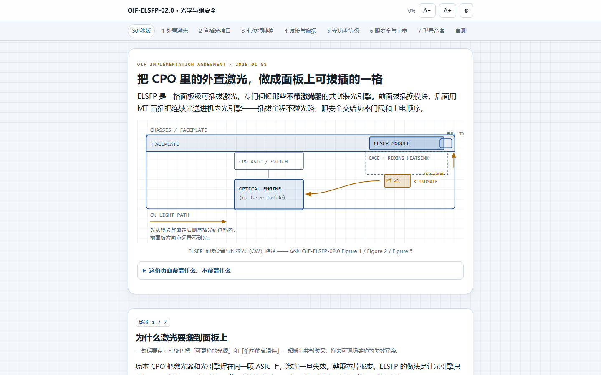

# OIF ELSFP 02.0 · 光学与眼安全交互速览

把 **OIF-ELSFP-02.0**（External Laser Small Form-factor Pluggable IA，2025-01-08）中最与日常测试相关的一段
—— **光接口 / 偏振分配 / 光功率等级 / 眼安全与上电流程** —— 做成一个**单文件、零外部依赖、可离线打开**的交互网页。

打开 `index.html` 即可，无需服务器、无需联网。

---

## 页面结构

| 场景 | 内容 |
|---|---|
| 首屏 | ELSFP 在面板上的位置与连续光（CW）路径示意 |
| 1 | 为什么把激光挪到面板上：可更换光源、眼安全、热解耦 |
| 2 | 盲插光接口：两级对准、模块侧无弹簧、MT 铁芯两种端面处理 |
| 3 | 七位硬键控：可点第 4 位切换「常规 / 直通」，含原文 6 组标准键 |
| 4 | Table 5 波长与偏振分配：4PMF / 8PMF × CWDM4 / 1311 四种组合可切 |
| 5 | Table 6 光功率等级：LP 11 → SHP 26 dBm 标尺，标出 APR 上限 |
| 6 | 眼安全与推荐上电流程：Hazard Level 1、250 ms APR、四步上电与损耗测量 |
| 7 | 型号命名解析：`*aMF-bb#-cc-kkkkkkk` 逐段拆解 |

结尾另有 3 题自测，答案都带出处角标。

## 怎么用

- **蓝色上标角标** → 点开看该说法的**英文原句 + 原文页码 + 中文转述**。全文共 34 条事实账本（`SOURCES`）。
- 顶部工具条：**明暗切换**、**字号 A−/A+**（记忆偏好）、**阅读进度**、**回到刚才的位置**。
- 键盘：`←` `→` 切场景，`Esc` 关弹窗。
- 移动端（390 px）已实测无横向溢出；`prefers-reduced-motion` 与 `prefers-color-scheme` 均被尊重。

## 数据可信度

- **读图**：Table 3 / Table 4 / Table 5 / Table 6 / Figure 22 / Figure 25 在原 PDF 中是矢量图，文本层取不到数值，
  页面上的数字是按 400–600 dpi 渲染后**逐格目视读出**的，标记为「读图」。
- **推算**：由原文数值换算得到的（例如 dBm → mW），标记为「推算」。
- 其余 32 条引文均已**逐字回原文核对**（脚本化分页匹配，允许 `[...]` 省略段）。

## 未覆盖内容

机械图纸与尺寸公差（图 8–19、22–27）、引脚定义与 CMIS 状态机（表 7–9）、
EIA-364-1000 性能测试要求、附录 C 术语表全文。请回原文 PDF。

## 原文

OIF-ELSFP-02.0, 2025-01-08, *Physical Link Layer – Co-Packaging Track*.
PDF 文本提取副本见 `docs/oif-elsfp-02.0-extracted-text.txt`。

---

本页内容为个人技术学习笔记，非 OIF 官方出版物；一切数值以原文 PDF 为准。
